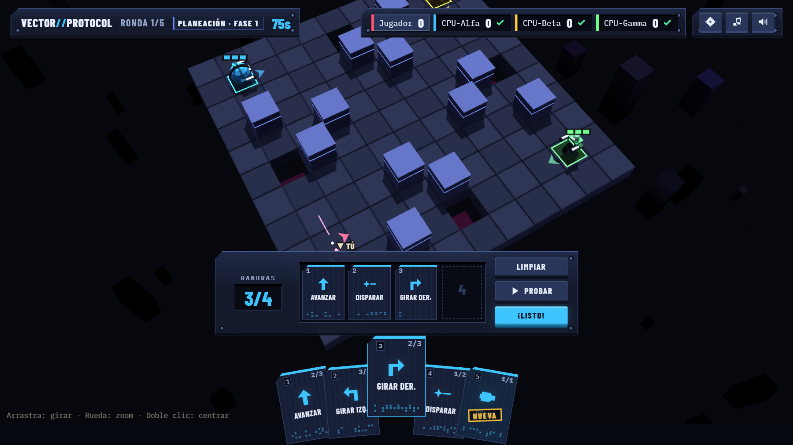

En **XcaliGames** nos gusta que las ideas se prueben jugando. Por eso hoy estrenamos la sección de **Juegos demo** en nuestro portal y abrimos al público el **Demo MVP** de nuestro nuevo proyecto táctico: **[Vector//Protocol](https://vector.xcaligames.cloud/)**.

No necesitas instalar nada ni crear una cuenta: entra desde tu computadora, teléfono o tableta a **[vector.xcaligames.cloud](https://vector.xcaligames.cloud/)** y despliega tu chasis en la arena en segundos.

## ¿Qué es Vector//Protocol?

**Vector//Protocol** es un *party game* táctico de programación de robots en 3D para **1 a 4 jugadores**. En lugar de controlar a tu robot con reflejos en tiempo real, cada fase armas una secuencia de instrucciones en tu riel de programa y observas cómo los cuatro bots ejecutan sus órdenes al mismo tiempo.

> **Secuencia el protocolo · Despliega el chasis · Domina la arena.** Un giro a tiempo empuja a tu rival directo a la lava; un cálculo mal medido te deja al borde del abismo cuando cae el suelo.

### Cómo funciona una partida

1. **Mejora tu kit cada ronda:** Al iniciar cada una de las 5 rondas eliges **1 de 3 módulos** para sumar a tu mazo. Hay cartas de acción (*Avanzar*, *Disparar*, *Embestir*, *Gancho*, *Mortero*, *PEM*, *Mina*, *Salto*), mejoras pasivas permanentes (*Blindaje*, *Coraza*, *Autorreparación*, *Turbo*) y **módulos malditos** de alto riesgo y gran poder (*Cañón de cristal*, *Sobrecalentado*, *Furia*).
2. **Sinergias de combate:** Reunir 3 módulos de una misma familia activa un bono táctico para tu chasis:
   - **Artillero:** Tus láseres atraviesan escudos.
   - **Ágil:** No pueden empujarte ni atraerte con ganchos.
   - **Ingeniero:** Tus minas hacen 3 de daño y los choques que provocas hacen 2.
   - **Táctico:** Ganas `+1` ranura adicional en tu programa.
3. **Ejecución simultánea y derrumbe:** Todos los pilotos ejecutan su programa paso a paso a la vez. A partir de la Fase 2, el borde exterior de la arena se desploma al vacío al final de cada fase, cerrando el espacio hasta que solo queda un bot en pie.

## Qué incluye este Demo MVP

Queríamos que cualquiera pudiera aprender las reglas en un par de minutos y armar una sala con amigos al instante:

- **Tutorial interactivo (2 minutos):** 3 lecciones rápidas para dominar el giro, el disparo y los peligros del terreno.
- **Solo contra la CPU:** Partidas completas contra 3 bots controlados por una IA con tres niveles de dificultad (*Fácil*, *Normal* y *Difícil*).
- **Salas en línea de 2 a 4 jugadores:** Crea una sala con un código de 4 letras y juega en modo **Batalla** (todos contra todos) o **Equipos 2 vs 2** sin fuego amigo (la CPU completa los lugares vacíos automáticamente).
- **11 chasis en 3D y paleta de pintura:** Elige entre *Tanque*, *Araña*, *Flotador*, *Mecha*, *Bola*, *Escorpión*, *Dron*, *Gólem*, *Monociclo*, *Centinela* o *Buggy*.
- **6 biomas dinámicos con música propia:** Desde la *Arena* clásica hasta *Fábrica* (cintas transportadoras), *Hielo* (superficie deslizante), *Volcán* (lava que crece), *Ciudad* (torretas neutrales) y *Laboratorio* (portales de teletransporte).

## Ingeniería: todo un juego 3D en ~290 KB

Fieles a nuestra filosofía de cero fricción, **Vector//Protocol** está construido sin motores pesados ni descargas eternas:

- **Motor WebGL2 y audio 100 % procedural:** Toda la geometría 3D de los 11 chasis, las sombras, los proyectiles y la banda sonora de cada bioma se generan por código en tiempo real.
- **Un solo archivo HTML (~290 KB):** El juego completo, incluyendo las tipografías técnicas (`Barlow Condensed` e `IBM Plex Mono`) y los iconos vectoriales, se compila en un único documento autocontenido.
- **Consola Táctica Sci-Fi en PC y móvil:** Diseñamos una interfaz inspirada en la cabina de mando de un mecha, con controles completos para ratón, teclado, mando (*gamepad*) y pantallas táctiles en orientación vertical u horizontal.

## ¡Pruébalo ahora!

El demo ya está activo y abierto para todo el mundo. Entra a **[https://vector.xcaligames.cloud/](https://vector.xcaligames.cloud/)**, elige tu chasis favorito y cuéntanos qué combinación de módulos te dio la victoria.
